# Emotion Detector

**An idea waiting to take shape.**

[Status](#status) · [Next steps](#implementation-checklist)

<table><tr><td width="33%" valign="top"><h3>Current status</h3>
No application code has been committed yet.
</td><td width="33%" valign="top"><h3>Implementation</h3>
Model, dataset, and interface are not specified.
</td><td width="33%" valign="top"><h3>Next milestone</h3>
Add a working prototype and setup guide.
</td></tr></table>

## Status

This repository is a placeholder for an emotion detection project. At the time this README was added, it contained no source code, trained model, dataset, or dependency manifest.

## Implementation checklist

- [ ] Define input format and target emotion labels.
- [ ] Select a dataset and document its license.
- [ ] Add a reproducible training or inference pipeline.
- [ ] Include setup commands, evaluation results, and a working demo.

Setup instructions and performance results will be documented when an implementation exists.
